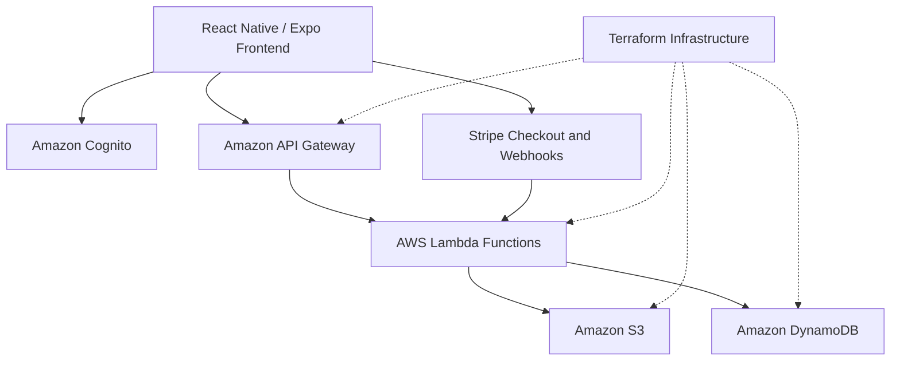

# CDW MarketShop | AWS Cloud Engineering Portfolio

## Project Overview

CDW MarketShop is a cloud-integrated marketplace application developed using AWS serverless technologies, REST APIs, and modern web development tools.

This portfolio documents the cloud architecture, integrations, and technical challenges addressed during development.

## AWS Technologies

- AWS Lambda — Serverless backend services
- Amazon API Gateway — HTTP API integration
- Amazon S3 — Product image storage
- AWS IAM — Resource permissions
- Amazon Cognito — User authentication
- Amazon DynamoDB — Application data storage
- Terraform — Infrastructure as Code

## Additional Technologies

- JavaScript and Node.js
- React Native and Expo
- REST APIs
- Stripe Checkout and webhooks
- Git and GitHub
- Vercel

## Key Engineering Work

### Serverless Development
Developed Lambda-based backend functionality for marketplace operations.

### API Integration
Connected frontend applications with AWS backend services using REST APIs.

### Cloud Storage
Implemented S3 image upload and retrieval workflows.

### Infrastructure as Code
Configured AWS resources using Terraform.

### Payment Integration
Integrated Stripe Checkout and webhook processing with order management.

### Troubleshooting
Investigated and resolved API connectivity, CORS, authentication, and deployment issues.

## Architecture Overview

Frontend (React Native / Expo)
    |
    +-- Amazon Cognito (Authentication)
    |
    +-- Amazon API Gateway
    |       |
    |       +-- AWS Lambda
    |       +-- Amazon S3
    |       +-- Amazon DynamoDB
    |
    +-- Stripe Checkout / Webhooks

Infrastructure managed using Terraform.

## Portfolio Scope

This repository contains project documentation and architecture summaries.

Production credentials, private configuration, and the original application's Git history are not included.

## AWS Architecture Diagram

*Simplified conceptual architecture. Some integrations also use Lambda Function URLs.*

## Project Screenshots

### Screenshot 1

### Screenshot 2

### Screenshot 3

